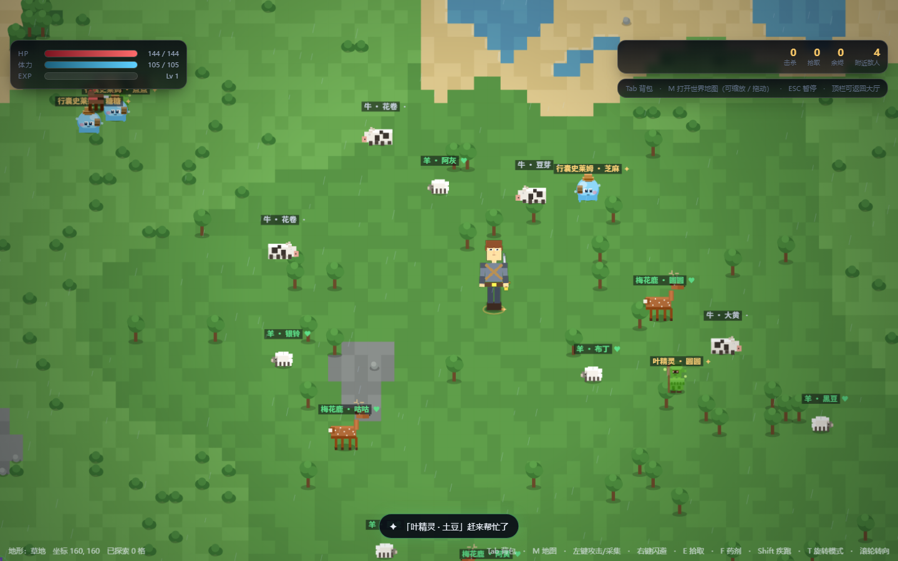

# 余烬回廊 · Ember Corridor

**🎮 在线试玩：<https://wut-person.github.io/ember-corridor/>**

一款**开放世界沙盒 RPG**（俯视角）+ 原始横版肉鸽闯关的可玩原型。纯前端、零依赖：所有图标是内联生成的 SVG，所有角色 / 生物 / 场景是代码绘制的像素精灵，音效是 WebAudio 现场合成。

**两种方式都能玩**：

| 方式 | 操作 |
|---|---|
| **在线（推荐）** | 打开 <https://wut-person.github.io/ember-corridor/> |
| **本地** | 直接双击 `index.html`（无需服务器、无需构建），按 `F11` 全屏 |



---

## 一、已实现的界面与系统

| 需求 | 实现位置 | 说明 |
| --- | --- | --- |
| ① 登录界面 | `js/ui/screen-login.js` | 代号输入、回廊入口（服务器）选择、**4 套初始外貌**（实时像素头像预览，与战斗内形象完全一致）、记住进度、继续上次进度 |
| ② 登录后的主界面 | `js/ui/screen-home.js` | 驯火者档案（等级/经验/战力）、远征记录、回廊图鉴、**动态角色立绘**（站立→奔跑→挥砍循环）、五项主菜单、任务追踪卡、今日委托、公告与存档重置 |
| ③ 游戏内的大厅界面 | `js/ui/screen-lobby.js` | 实时 Canvas 营地场景（篝火 / 任务板 / 铁砧 / 补给箱 / 试衣镜 / 回廊之门 / 传送门），鼠标点击可移动主角；6 个**发光互动热点**；右侧纸娃娃与系统导航；`type:'stages'` 时为关卡选择大厅 |
| 细分 1：任务角色 | `js/ui/screen-character.js` + `js/core/state.js` | 装备槽位（头盔/胸甲/腿甲/披风）、**实时换装立绘**、外观预设切换、属性总览（攻击/攻速/距离/暴击/防御/生命/体力/战力）、衣柜（已拥有 + 未收集灰显）、天赋改造入口 |
| 细分 2：人物的衣物 | `js/data/clothing.js` | 17 件衣物，4 个槽位，稀有度 / 等级需求 / 防御·生命·体力·移速·暴击加成 / 外观主色（换装后战斗中的像素角色颜色立即改变） |
| 角色外观系统 | `G.LOOKS` + `js/core/sprites.js` | 外观 = 体型（slim/broad）+ 发型（bob/bun/long/short）+ 胡须 + 披风/斗篷 + 护甲·皮带·护腕·腰带·靴子配色。两套主打外观按参考立绘还原：**余烬剑姬**（棕发齐肩女剑士，铁灰胸甲 + 腰间短剑）与**铁壁游侠**（发髻络腮胡重装男游侠，宽斗篷 + 背弓） |
| 细分 3：场景的互动 | `js/data/clothing.js`(`HUB_SPOTS`) + `screen-lobby.js` + `screen-mods.js` | 6 个大厅互动点（各自打开对应系统）、篝火增益选择、关卡选择、铁砧「场景互动」页可跳转到任意互动点 |
| 细分 4：背包界面 | `js/ui/screen-inventory.js` | 分类标签（全部/武器/衣物/消耗品/材料/图纸，带数量角标）、物品网格（稀有度描边 + 数量 + 已装备标记）、悬停气泡、右侧详情面板、装备 / 出售 |
| 细分 5：武器的使用与样式介绍 | `weapons.js` + `icons.js` + `screen-inventory.js` | 16 把武器（11 种类型），每把有 SVG 图标、攻击力/攻速/距离/暴击/重击倍率/体力消耗/投射物参数、**被动效果**、**武器战技（Q 位别名，称号技能缺失时回落）名称 · 体力 · 冷却 · 说明**、**按键使用方法**、武器简介与风味文本；详情面板会与当前装备对比数值 |
| 细分 6：任务的界面 | `js/ui/screen-quests.js` + `js/data/quests.js` | 20 项任务（主线 5 / 支线 6 / 悬赏 4 / 日常 4…… 共 17 项在列 + 等级门槛），接取 → 追踪 → 完成 → 交付全流程，奖励预览、进度条、目标资料（敌人行为与弱点）、刷新进度、放弃任务 |
| ④ 开放世界（沙盒） | js/game/world.js + worldview.js + js/ui/screen-world.js | 320×320 程序化大陆（8 种地形）、自由漫游与相机跟随、遭遇战与稀有度掉落、细雨与植被摆动氛围、M 键可缩放世界地图 |
| 额外的战斗核心 | `js/game/engine.js` + `js/game/boot.js` | 横板关卡：5 层、每层 3~5 房间、每房 1~3 波、精英词缀 5 种、首领 3 种（含二阶段 AI）、掉落与拾取、传送门推进、结算界面、暂停菜单 |
| 操作与技能体系 | `js/data/titles.js` + `engine.js` + `boot.js` | 8 键位横板标准布局（WASD 移动 + 鼠标攻击 + 右键/Q 技能 + Shift 闪避 + E 交互）、三段连招、10 档称号 × 4 条技能线与 10 条被动、四个固定技能位 HUD 与冷却闪烁（详见第二 ~ 五章） |

---

## 二、操作方式（横板 2D · 键鼠标准布局）

> ⚠️ 本作现在有**两种玩法**：**开放世界沙盒**（主推，见下节）与**回廊远征闯关**（原有的横板肉鸽，完整保留）。
> 顶栏 / 营地按钮可在两者之间切换。

### 开放世界（俯视角沙盒）操作

| 按键 | 功能 |
| --- | --- |
| `W` `A` `S` `D` / 方向键 | 八方向自由移动（水中与森林会减速） |
| `Shift` | 疾跑（消耗体力，速度 ×1.7） |
| 鼠标左键 | 三段挥砍（自动朝移动方向或准星方向出手，近身有 60° 软吸附） |
| 鼠标右键 | 闪避（朝准星方向位移 + 无敌帧） |
| `E` | 拾取掉落物（也可以直接踩上去自动吸取） |
| `F` | 使用药剂 |
| **`M`** | **打开世界地图**（滚轮缩放 / 拖拽平移 / 双击放大定位 / `方向键` 平移 / `+` `-` 缩放） |
| `Esc` | 暂停（暂停面板可继续或返回营地） |
| 鼠标位置 | 决定攻击与闪避方向；站定时朝向跟随准星 |

### 横板远征（原有玩法）操作

**战斗内**：WASD 负责移动，鼠标 + 功能键负责攻击与技能。角色左右朝向由**鼠标水平位置自动判定**（鼠标在右则面向右），无需额外切换键；所有键位在「凡人 → 升神者」全称号区间内**固定不变**。

| 按键 | 功能 | 操作类型 |
| --- | --- | --- |
| `A` / `D`（或 ←→） | 左右水平移动；按住持续移动，松开自然减速；奔跑时脚下扬尘 | 移动 |
| `W`（或 `空格`） | 跳跃：**短按小跳、长按高跳（+60%）**，空中可二段跳 | 移动 |
| `S` | 地面按下蹲（受击框 40 → 20，可躲高位攻击）；**奔跑中按触发滑铲**（低矮碰撞盒 + 拖地尘土）；空中按加速下落 | 移动 |
| 鼠标左键 | 普通攻击：连点触发**三段连招**（平斩 → 上挑浮空 → 下劈砸地），有输入缓冲；空中点击为斜向空中攻击 | 攻击 |
| 鼠标右键 | **主技能**（核心输出，随称号进化） | 技能 |
| `Q` | **副技能**（辅助 / 控制 / 范围清场，随称号进化） | 技能 |
| `Shift` | **突进闪避**：短距离位移 + 无敌帧 + 残影；命中判定后可用它**取消普攻后摇** | 机动 |
| `E` | **交互 / 拾取 / 开门**：靠近可交互物体时头顶弹出黄色按键提示 | 交互 |
| `F` / `1` `2` | 使用道具 / 切换携带道具（旧键位保留） | 通用 |
| `M` | 静音开关 | 通用 |
| `Esc` | 暂停 / 继续（暂停菜单可重开或放弃结算） | 通用 |
| 鼠标位置 | 决定朝向、攻击角度与准星；远程形态额外显示虚线瞄准辅助线，范围技能显示落点预测圈 | 通用 |

**界面内**：鼠标点击；`Esc` 返回上一层；顶栏可切换音效、返回登录、进入角色页。

---

## 三之前 · 人物朝向旋转（WASD 八方向）· 新增

人物可以**原地转身**：按 WASD（含组合键）就让角色转到对应方向，脚下有橙色扇形指示器实时显示朝向。

| 操作 | 效果 |
|---|---|
| `W` / `A` / `S` / `D` | 人物转向北 / 西 / 南 / 东（**原地转，不需要先移动**） |
| 组合键（如 `W`+`D`） | 转向 45° 的对角方向（东南 / 西南 / 西北 / 东北） |
| **鼠标滚轮** | 相对当前朝向 ±45° 微调（连续滚动可逐档累积） |
| `T` | 切换旋转模式：**开** = WASD 决定朝向 / **关** = 朝向跟随移动方向与鼠标 |

**八方向档位**：东 → 东南 → 南 → 西南 → 西 → 西北 → 北 → 东北（每档 45°）。

**实现要点**：

- 8 个档位与烘焙的 8 个朝向精灵图**一一对应**，转到哪个方向就取哪个朝向的图
- 平滑转向：旋转模式下每帧按 `dt × 42` 收敛（约 10 帧转满 180°），手感跟手
- 敌人软吸附保留：140° 前向弧内取最近目标，越近越优先（避免被侧后的敌人带偏朝向）
- 朝向指示器：脚下底盘圆环 + 朝向扇形 + 箭头尖，旋转模式下高亮为橙色

## 三之前 · 大世界生物与背包（Tab）· 新增

### 生物体系：中立 / 善良 / 无攻击

世界里生活着 5 个**不同种类**的生物，每只都有自己的**姓名**（种类 + 专属名字，如「牛 · 奶酪」），
头顶显示姓名与性情标记：

| 种类 | 性情 | 栖息地 | 生命 | 移速 | 掉落 | 说明 |
|---|---|---|---|---|---|---|
| 猪 | 中立 | 陆地 | 40 | 16 | 生肉 · 余烬粉 | 圆滚滚的粉猪，拱土找食，被惹到会用鼻子顶人 |
| 牛 | 中立 | 陆地 | 70 | 13 | 生肉 · 余烬 | 黑白花牛，安静吃草，护崽时会低头冲撞 |
| 羊 | **善良** | 陆地 | 45 | 15 | 毛料 · 生肉 | 毛蓬蓬的绵羊，性格温顺，会跟着你走一段路 |
| 鸡 | **无攻击** | 陆地 | 18 | 24 | 生肉 · 羽毛 | 小跑着啄食的母鸡，一有动静就扑棱着翅膀跑开 |
| 鱼 | **无攻击** | 水中 | 12 | 30 | 生鱼 | 浅水里游动的鱼，见到人影就摆尾钻进深水 |

| 性情 | 标记 | 颜色 | 行为 |
|---|---|---|---|
| 中立 | `·` | 银白 | 不主动攻击；玩家贴太近会走开，被打会还手 |
| 善良 | `♥` | 绿色 | 靠近会跟随玩家一段路（脚下有暖光圆环） |
| 无攻击 | `~` | 蓝色 | 完全无攻击性，见人就跑 |

**行为特性**：

- 陆生生物**不会走进深水**，鱼**不会上岸**（按栖息地校验，碰壁就折返）
- 每只生物有独立思考计时（1.4~3.6 秒决策一次）：随机游荡 / 跟人 / 避让
- 世界里常驻 22 只，离玩家超过 1400px 自动回收并在远处补新的
- 在**草地 / 草甸**上牛羊更多，**森林**里鸡更多，**浅水 / 深水**只出鱼

### 采集物与生物产物（8 种新物品）

生肉 · 生鱼 · 毛料 · 羽毛 · 木头 · 沙子 · 水袋 · 石块 —— 全部有独立图标，可入包、可堆叠。

### Tab 背包

| 按键 | 效果 |
|---|---|
| `Tab` | 打开 / 关闭**世界内背包浮层**（世界暂停，不离开地图） |
| `ESC` | 也能关闭背包（优先于暂停） |

浮层内容：按「消耗品 / 材料与采集物 / 图纸」分组显示物品（图标 + 数量 + 名字），
右侧显示当前武器与四个装备槽、快捷键说明。点遮罩空白处也能关闭。

### 可破坏资源（木头 / 沙子 / 水 / 石块）

树木、灌木、岩石、沙滩与水域都能被破坏并掉落物品，掉落直接进背包。

| 资源 | 类型 | 耐久 | 动作 | 掉落 |
|---|---|---|---|---|
| 树木 | 场景物件 | 3 下 | 砍伐 | 木头 2~4、羽毛 0~1 |
| 松树 | 场景物件 | 3 下 | 砍伐 | 木头 2~5 |
| 灌木 | 场景物件 | 2 下 | 采集 | 木头 1~2、毛料 0~1 |
| 岩石 | 场景物件 | 4 下 | 开采 | 石块 2~4、废旧金属 0~1 |
| 沙地 | 地形（沙滩） | 2 下 | 挖掘 | 沙子 1~3 |
| 水源 | 地形（浅水 / 深水） | 2 下 | 取水 | 水袋 1~2 |

**怎么采**：用**鼠标左键挥砍** —— 附近没有敌人时，这一刀会自动打向射程内、朝向锥形内最近的资源。
准星附近出现黄色虚线圈与「砍伐树木」这类提示就表示可以采。

- 场景物件破坏后**消失**，约 45 秒后**重生**；地形类（沙 / 水）不消失但有 0.42 秒冷却
- 破坏时结算掉落并弹提示，物品落地后自动吸附拾取
- 被砍中的资源会**左右抖动**，破坏时有碎裂特效

### 遗迹与品质掉落

大世界散布遗迹：靠近时守卫苏醒，清空后掉落武器 / 装备。

| 遗迹 | 尺寸 | 档位 | 守卫 | 说明 |
|---|---|---|---|---|
| 石环遗迹 | 5×5 | 1~3 | 1~2 只 | 半埋在土里的立石围成一圈 |
| 坍塌塔基 | 6×6 | 1~4 | 2~3 只 | 塌了一半的塔，砖缝里长满草 |
| 沉没地窖 | 5×5 | 2~5 | 2~4 只 | 下陷的石砌地窖，里面比外面冷 |
| 余烬祭坛 | 6×5 | 3~6 | 3~5 只 | 还亮着余火的祭坛 |

**档位由离出生点的距离决定** —— 越远的遗迹档位越高、守卫越强、掉落越好（1~6 档）。
进入遗迹 260px 范围守卫苏醒；4 档以上的守卫是**精英**（带随机词缀）。

**遗迹守卫**：遗迹朽尸 / 石卫哨兵 / 遗迹弓手 / 遗迹守卫 / 余烬幽影 / 虚空回响（近战 · 远程 · 冲锋三类）。

**品质掉落概率**（与需求一致）：

| 品质 | 颜色 | 概率 | 说明 |
|---|---|---|---|
| 白 | 灰白 | 45%（兜底档） | 需求 70% 为「白档基准」 |
| 蓝 | 蓝 | **50%** | 与需求一致 |
| 紫 | 紫 | **4%** | 与需求一致 |
| 金 | 金 | **0.6%** | 与需求一致 |
| 红 | 红 | **0.002%** | 极品，10 万次约 2 次 |

清空遗迹后掉落 1~2 组战利品（武器或装备），3 档以上多一次机会，紫档以上额外附带材料。

### 参考图生物体系（攻击 / 友善援护 / 善良）

按参考图新增 8 个生物，大世界现在共 **10 种中立与善良生物 + 13 种敌人**。

**性情新增「友善援护 ✦」（金黄标记）** —— 会主动打攻击生物保护你：

| 性情 | 标记 | 行为 |
|---|---|---|
| 中立 | `·` 银白 | 不主动攻击，被打会还手 |
| 善良 | `♥` 绿色 | 亲近玩家，会跟随一段路 |
| 无攻击 | `~` 蓝色 | 见人就跑 |
| **友善援护** | `✦` 金黄 | **主动锁定并攻击附近的攻击生物** |

**3 个攻击生物**（主动攻击玩家）：

| 名称 | 生命 / 攻击 | 造型特征 |
|---|---|---|
| 幽影狼 | 58 / 13 | 黑毛、**红眼**、外露獠牙、上翘蓬松尾 |
| 藤蔓魔 | 130 / 17 | 绿藤躯、**胸口橙色火核**、肩背尖刺、藤鞭右臂 |
| 墓碑骷髅 | 74 / 15 | 白骨、**蓝色鬼火眼**、肩扛拱顶墓碑、破斗篷 |

**2 个友善援护生物**（会帮你打怪）：

| 名称 | 生命 / 攻击 | 说明 |
|---|---|---|
| 叶精灵 | 60 / 12 | 绿叶斗篷、尖耳、木杖，近战；周围飘荧光 |
| 行囊史莱姆 | 80 / 10 | 蓝色果冻身、棕色圆帽、斜挎背包，**远程吐水弹** |

赶来帮忙时会弹提示「叶精灵 · 豆芽 赶来帮忙了」。**援护生物免疫你的攻击**，不会误伤。

**3 个善良生物**（你可以猎取）：

| 名称 | 生命 | 掉落 | 造型特征 |
|---|---|---|---|
| 梅花鹿 | 55 | 生肉 / 毛料 / **鹿角** | 白色梅花斑、分叉鹿角 |
| 野猪 | 85 | 生肉 / **野猪獠牙** / 废旧金属 | 竖立鬃毛、白色獠牙 |
| 青蛙 | 16 | 生肉 / **黏液凝胶** | 鼓出的黄眼、白肚 |

**新增能力**：玩家的挥砍现在**也能打生物**了（此前只对敌人生效）。被打的生物会**逃开 3 秒**。

## 三、开放世界（俯视角沙盒）· 新增

**世界**：`320 × 320` 格程序化大陆（约 10 万格），从世界中心生成、四周是海。地形按参考风格分 8 层：

| 地形 | 占比 | 特性 |
| --- | --- | --- |
| 深水 | 34.3% | 不可通行 |
| 浅水 | 6.3% | 可涉水，移速 60% |
| 沙滩 | 6.2% | 陆地，偶有石块 |
| 草地 | 9.8% | 陆地，稀疏树木 |
| 草甸 | 19.0% | 陆地，灌木点缀 |
| 森林 | 18.6% | 移速 85%，树木/灌木密集，危险度高（精英概率 +） |
| 岩地 | 5.2% | 石块点缀，危险度高 |
| 雪地 | 0.6% | 高海拔，松树 |

**玩法**：自由漫游 → 遭遇敌人 → 三段挥砍击杀 → 掉落装备与材料（按稀有度着色）→ 拾取即时进入背包 →
在角色页换装即时生效。危险度随「已探索距离」与所在地形提升，越走越强。

**氛围**：俯视角像素地形（每格两种色阶做斑驳）、水陆交界白浪、树木随风摆动、细雨粒子、屏幕暗角。

**世界地图（`M`）**：整张世界预渲染成缩略图（960×960），地图视图对它做变换绘制，因此 10 万格也能瞬间打开。

- 缩放范围 **5% ~ 400%**（滚轮以光标为锚点，缩放时光标下的地点保持不动）
- 拖拽平移 / 双击放大定位 / `方向键` 平移 / `＋` `－` `全局` `回到我` 四个按钮
- 叠加显示：玩家脉冲标记、当前视野矩形、敌人红点、比例尺、光标下坐标与地形名

**新增文件**

| 文件 | 作用 |
| --- | --- |
| `js/game/world.js` | 地形数据层：确定性值噪声 + fBm、8 种地形、装饰物布点、出生点搜索、可通行/减速判定、地图缩略图渲染 |
| `js/game/worldview.js` | 世界主循环：相机跟随、视口裁剪渲染、漫游与碰撞、敌人 AI 与生成、三段攻击与掉落、特效与雨天、HUD 同步 |
| `js/ui/mapview.js` | 大地图控制器：缩放/平移/定位、玩家与敌人标记、比例尺、图例 |
| `js/ui/screen-world.js` | 开放世界界面装配：HUD（生命/体力/EXP + 统计）、暂停面板、入口按钮 |

---

## 四、3D 体素角色（Godot 烘焙）· 新增

角色由 **Godot 4 体素 3D 工程**建模，烘焙成 8 朝向精灵图后接入游戏 —— 游戏本身仍是零运行时依赖的纯前端。

### 4.1 生成管线

`
godot-voxel/（Godot 4 工程）
  main.gd      盒子（BoxMesh）拼体素模型 → 8 朝向渲染 → 导出 PNG
      ↓  godot --path godot-voxel -- --render --out=.../sheets
godot-voxel/sheets/   2112 张透明 PNG（8 角色 × 8 朝向 × 33 帧）
      ↓  复制
assets/hero/          游戏读取的精灵图目录
`

### 4.2 角色清单（8 个 = 4 职业 × 2 性别）

| ID | 名称 | 性别 | 职业 | 造型要点 |
|---|---|---|---|---|
| lk_a | 余烬剑士 | 男 | 剑士 | 棕短发、钢灰肩甲、交叉皮带、黄铜腰扣 |
| lk_b | 铁壁游侠 | 男 | 游侠 | 宽檐帽、络腮胡、棕皮革甲 |
| lk_c | 虚空秘术 | 男 | 法师 | 紫色光环（12 段发光环）、发光眼、法杖紫水晶 |
| lk_d | 金穗骑士 | 男 | 骑士 | 高顶全罩头盔（面缝+呼吸孔）、塔盾金色箭徽 |
| lk_a_f | 余烬剑姬 | 女 | 剑士 | 露腰束胸、迷你短裙、大腿靴 |
| lk_b_f | 铁壁游侠（女） | 女 | 游侠 | 同上 + 宽檐帽 / 背弓 |
| lk_c_f | 虚空秘术（女） | 女 | 法师 | 同上 + 光环 / 法杖 / 发光眼 |
| lk_d_f | 金穗骑士（女） | 女 | 骑士 | 同上 + 塔盾 |

### 4.3 动画片段与帧率

**60 FPS 播放**：角色动画按 60 帧/秒驱动（此前立绘被限在 30 FPS，已解除）。
实测：大世界角色绘制 **59.9 FPS**、角色页立绘 **60.2 FPS**。

每个角色烘焙 **33 帧**，分成 9 个动画片段（帧间用关键帧线性插值生成，所以动作连贯）：

| 片段 | 帧数 | 播放帧率 | 触发条件 |
|---|---|---|---|
| `idle` | 2 | 1.6 fps | 静止（呼吸） |
| `walk` | **8** | 10 fps | 移动中（与移动速度同步，脚不打滑） |
| `run` | **8** | 14 fps | Shift 疾跑 |
| `atk1` | 3 | 26 fps | 三段连招第 1 段（起手，剑上举） |
| `atk2` | 3 | 26 fps | 连招第 2 段（横挥） |
| `atk3` | 3 | 26 fps | 连招第 3 段（下劈，伤害 ×1.35） |
| `skill` | 4 | 12 fps | 技能蓄力 → 下压释放 |
| `hurt` | 1 | — | 受击（后仰） |
| `crouch` | 1 | — | 按下 S（压低身体） |

**帧号取法**（`sheetFrameOf()`）：

- `walk` / `run`：由 `ph`（移动相位）直接映射到帧号 —— 移动越快帧越密，**脚不会打滑**
- `atk1~3` / `skill`：由 `atkT` / `castT` 的进度取帧 —— 动作不会拖尾或提前结束
- `idle` 等：按 `SHEET_CLOCK × 片段帧率` 循环

**加载策略**：按需加载单张帧（`assets/hero/<角色>_d<朝向>_<片段>_<帧号>.png`）。
进入界面先预取 `idle` + `walk` 共 80 张（角色能立刻动起来），其余片段在用到时才请求。
目标帧未加载完时退化到待机帧，不会闪烁。

**武器**：剑士 / 骑士握长剑（骑士另有塔盾）、游侠背长弓、法师持法杖（带发光紫水晶）。
每个动作的手臂角度与握武器角度都单独调过，所以普攻能看到明显的挥砍弧线。

### 4.4 人物选择界面

- **性别切换**：♂ 男 / ♀ 女 / 全部
- **角色网格**：4 列卡片，显示体素立绘 + 性别图标 + 名字
- **旋转动画**：选择人物时大立绘转一圈（约 1.5 秒），横向压缩 + 背视帧模拟 3D 转身
- 也可点 🔁 转一圈 手动重播

## 五、动作体系（像素表现与碰撞变化）

| 动作 | 动作逻辑 | 碰撞变化 | 像素表现 |
| --- | --- | --- | --- |
| 水平奔跑 | 行走 / 奔跑两档速度（满速 250 × 移速加成） | 受击框 26 × 40，脚下贴合地面 | 披风向后扬起；每 0.11 秒甩出方块尘土 |
| 跳跃 | 起跳蓄力 → 滞空 → 落地缓冲；长按托举 0.26 秒 | 空中判定按中心点；碰撞盒离地 | 起跳压出尘土；落地按下落速度压出 5~8 粒长条尘土并身体压缩 |
| 下蹲 / 滑铲 | 站立按下蹲（移速 45%）；奔跑（> 170）按滑铲 0.34 秒 | 受击框高度**减半**（40 → 20） | 滑铲拖出灰色残影 + 长条尘土 |
| 三段连招 | 1.1 秒内连点衔接；动作尾声 0.28 秒点击进缓冲队列 | 范围系数 1.0 / 1.08 / 1.25；第 2 击挑飞、第 3 击砸地眩晕 | 三段不同弧线（平扫 / 上挑 / 下劈）；停帧 0.045 / 0.075 秒；第 3 击溅碎石 |
| 空中攻击 | 向准星方向斜向斩，可轻微改变下落轨迹 | 斜向判定，命中弹跳（vy ≤ -180） | 身体前倾 0.06 弧度；命中爆 6 粒火花 |
| 闪避突进 | 位移 0.16 秒 × 距离系数，全程无敌；高阶解锁连闪与瞬移 | 位移期间受击框关闭；相位型可穿人 | 残影 0.3 秒渐隐；冲击型在终点爆发 |
| 受击硬直 | 轻击 0.2 秒 / 重击（≥ 12% 最大生命）0.5 秒，期间无法攻击与闪避 | 受击框略缩；被击退 | 角色闪白 1 帧 + 3 个红色伤害像素 + 红闪震屏 |
| 拾取 / 交互 | 掉落物 86 px、传送门半径 + 46 px 内按 `E` 生效 | 无攻击判定 | 头顶黄色感叹号提示；拾取爆出稀有度色光点 |

---

## 六、称号与技能进化体系

**核心规则**：同一按键永远是同一类技能，随称号晋升只升级效果 / 视觉 / 机制；**第 5 档正式分化为近战与远程两条分支**（誓约骑士线 / 秘法师线），引擎按武器类型自动选线（弓 / 弩 / 法杖走远程），玩家无需手动切换。称号由**累计余烬**解锁。

| 档位 | 称号 | 累计余烬 | 左键（近战 / 远程） | 右键（近战 / 远程） | Q | Shift |
| --- | --- | --- | --- | --- | --- | --- |
| 1 | 凡人 | 0 | 铁剑斩击 / 奥术弹 | 猛力劈砍 / 秘法火球 | 应急包扎 | 快步闪避 |
| 2 | 勇武之士 | 800 | 发力斩 / 发力箭 | 破甲斩 / 穿甲箭 | 战斗怒吼 | 冲撞闪避 |
| 3 | 启灵者 | 2600 | 附灵斩 / 附灵弹 | 灵魂冲击波 / 灵魂洪流 | 灵魂视野 | 灵魂突进 |
| 4 | 塑能学徒 | 6000 | 塑能剑刃 / 塑能弹幕 | 魔力爆发 / 奥术新星 | 魔力护盾 | 魔力闪现 |
| 5 | 誓约骑士 / 秘法师 | 12000 | 誓约圣斩 / 秘法连弹 | 圣盾反击 / 秘法屏障 | 圣疗术 | 誓约冲锋 |
| 6 | 冠冕超凡 | 22000 | 领域斩击 / 奥术弹幕 | 圣誓裁决 / 陨石术 | 领域庇护 | 领域冲锋 / 闪现跃迁 |
| 7 | 灵墟行者 | 38000 | 灵魂虚影斩 / 魂能弹 | 魂火斩 / 灵魂风暴 | 灵魂替身 | 魂穿闪避 / 空间折跃 |
| 8 | 道标领主 | 62000 | 法则斩击 / 律令弹 | 法则镇压 / 律令牢笼 | 召唤畸变仆从 | 法则突进 / 空间折跃 |
| 9 | 灰芒半神 | 98000 | 灰芒神裁 / 神性射线 | 灰芒审判 / 神性陨落 | 神性化身 | 神行突进 / 空间折跃 |
| 10 | 升神者 | 150000 | 新元之剑 / 创世光束 | 神罚之剑 / 创世烈焰 | 新元结界 | 虚空神行 / 空间折跃 |

**被动技能**（随称号自动生效）：求生本能（低血加速）→ 战斗直觉（第三段 +30%）→ 灵魂感知（自动吸附）→ 魔力亲和（冷却 -15%）→ 圣誓守护（致命保命）→ 领域感知（敌人预警）→ **灵魂不灭（每局首次死亡原地复活）** → 法则压制（周围敌人攻击 -20%）→ 神性威压（敌人靠近减速）→ 新元法则（真实伤害）。

**技能栏**：HUD 右上角常驻「左键 / 右键 / Q / Shift」四个固定技能位，显示技能名、体力消耗与冷却剩余秒数；**冷却归零瞬间播放像素闪烁提示**，称号徽章同屏显示当前称号与被动名。数据层见 `js/data/titles.js`，技能效果由 `G.skillFor(槽位, 称号档位, 是否远程)` 解析。

---

## 七、操作手感优化

1. **连招输入缓冲**：动作尾声 0.28 秒内的点击自动排队，在剩余 ≤ 0.12 秒时接招，避免手速误差断连。
2. **技能取消后摇**：命中判定生效后，`Shift` 闪避可即时打断普攻后摇，提升连段流畅度。
3. **空中操作修正**：空中可微调方向（加速系数 4.2，地面为 12），跳跃高度随按键时长变化。
4. **鼠标指向精度**：攻击角度以角色为圆心跟随鼠标实时计算；远程与投射类技能显示瞄准辅助线，范围技能显示落点预测圈。
5. **冷却提示**：冷却期间图标覆盖剩余秒数，归零瞬间对应技能位像素闪烁（主技能橙红 / 副技能紫 / 闪避青）。

---

## 八、目录结构

```
index.html                 入口（按顺序加载 29 个脚本，无模块化依赖）
css/
  global.css               设计变量、启动动画、背景、Toast/Tooltip/Modal
  ui.css                   组件（按钮/面板/槽位/稀有度/标签页）与三大界面布局
  game.css                 战斗 HUD（含四个技能位与冷却闪烁）、结算、暂停、载入
js/
godot-voxel/               Godot 4 体素 3D 角色工程
  main.gd                  体素建模 + 8 朝向渲染脚本
  sheets/                  128 张烘焙精灵图
assets/hero/               游戏读取的精灵图（8 角色 × 8 朝向 × 2 帧）
  data/                    纯数据层
    weapons.js             16 把武器 + 11 种类型说明 + 随机词条生成
    clothing.js            17 件衣物 + 4 外观预设 + 大厅互动点 + 5 层关卡 + 篝火增益
    items.js               消耗品/材料/货币/图纸 + 掉落权重表 + 商店库存
    enemies.js             11 种敌人 + 5 种精英词缀
    quests.js              20 项任务 + 进度判定 + 奖励
    titles.js              10 档称号 + 4 条技能线（近战/远程双分支）+ 10 条被动
  core/
    util.js                工具函数、元素构造、Canvas 适配、余烬粒子
    audio.js               WebAudio 程序化音效（挥砍/命中/暴击/拾取/升级…）
    state.js               存档（localStorage）、背包、装备、天赋、任务、埋点统计
    sprites.js             像素精灵：主角（含换装/武器/三段弧线/下蹲/残影）、11 种敌人、场景道具、火焰
    icons.js               程序化 SVG 图标：武器 / 物品 / 衣物 / 战技
    bootstrap.js           启动日志与首屏引导
  ui/
    kit.js                 屏幕管理、Toast、Modal、Tooltip、顶栏、立绘画布、组件工厂
    screen-login.js        ① 登录界面
    screen-home.js         ② 登录后主界面
    screen-lobby.js        ③ 游戏内大厅（营地 / 关卡选择）
    screen-character.js    角色 / 衣物 / 外观 / 属性
    screen-inventory.js    背包 / 武器样式与说明
    screen-quests.js       任务界面
    screen-world.js        ④ 开放世界（沙盒）界面与暂停面板
    mapview.js             M 键世界地图（缩放 / 平移 / 标记）
    screen-mods.js         铁砧：武器强化 / 词条镶嵌 / 天赋 / 商店 / 场景互动
  game/
    world.js               开放世界地形数据层（噪声、8 地形、装饰物、出生点、地图缩略图）
    worldview.js           开放世界主循环（相机跟随、漫游、遭遇战、掉落、特效与雨天、HUD）
    engine.js              横板战斗核心（物理、三段连招、四个技能位、称号状态效果、领域与仆从、交互拾取、结算）
    boot.js                战斗界面装配（HUD、称号徽章、技能栏、结算、暂停）
tools/
  smoke-test.js            Node 无头冒烟测试（最小 DOM 桩，14 项功能检查）
  cdp-test.js              真实浏览器验证（Edge headless + CDP，逐屏截图）
  probe-title.js           称号 / 技能位运行时探针
  looks.js / one-look.js / pair.js   外观对比渲染（与参考立绘逐项核对）
  bounds.js / sprite-bbox.js  精灵包围盒测量工具
  shots/                   浏览器验证截图
PRD-余烬回廊.docx         产品需求文档（23 页 / 40 张表格，含第 9 章操作与技能体系）
```

---


### 测试临时目录自动清理

浏览器测试脚本每次运行都会创建临时浏览器配置（每个约 53 MB）。现在统一用**运行器**执行，
临时文件全部落在沙箱目录 `%TEMP%\_dsh-test-<pid>\`，**脚本退出时整目录自动删除**——
不会再把 C 盘越跑越满（此前 18 个脚本累计留下过 15.7 GB）。

```bash
# 跑单个套件（推荐，自动清理）
node tools/_run.js smoke-test

# 跑全部 12 个核心套件并汇总
node tools/_run.js --all

# 列出所有可用套件
node tools/_run.js --list
```

清理器还做两件事：

- **历史清扫**：顺手删掉 `%TEMP%` 里超过 1 小时的旧测试沙箱
- **占用容忍**：浏览器偶尔还占着个别文件时，重试 3 次后跳过并在下次运行再清

（仍然可以直接 `node tools/xxx-test.js` 跑，那样不会自动清理；要清理就用 `_run.js`。）

## 九、自测方式

```bash
# 1) 无头冒烟：加载全部脚本，走通 登录→主界面→大厅→各子界面→战斗→结算→存档
#    并验证操作体系（长按跳 / 下蹲 / 滑铲 / 三段连招 / 四个技能位 / E 交互 / 手感优化）
#    以及开放世界（地形生成 / 出生点 / 通行与减速 / 连通性 / 地图缩略图）
node tools/_run.js smoke-test

# 2) 真实浏览器：启动 Edge headless，逐屏截图并收集控制台报错（需要 Edge）
node tools/cdp-test.js

# 3) 开放世界专项验证（进入世界 / 漫游 / 遭遇战掉落 / M 键地图缩放拖动 / 暂停面板）
node tools/world-test.js

```bash
# 体素角色自检（只建模型、不渲染）
"$GODOT" --path godot-voxel --headless --quit-after 200

# 重新烘焙全部精灵图（8 角色 × 8 朝向 × 2 帧 = 128 张）
"$GODOT" --path godot-voxel --rendering-driver d3d12 --resolution 320x320 \
  -- --render --out="$PWD/godot-voxel/sheets"

# 把精灵图同步到游戏资源目录
cp godot-voxel/sheets/*.png assets/hero/
```

# 4) 称号与技能位探针（可选）
node tools/probe-title.js
```

当前结果：**29 个脚本加载正常、21 项功能冒烟全部通过、15 项旋转 / 9 项生物 / 7 项采集 / 5 项遗迹 / 5 项新生物测试通过、13 项边界场景通过、13 个自检套件全绿、线上版本 10/10 通过、角色动画 60 FPS、0 个控制台错误**。

### 验证线上版本

改了东西推到 GitHub 后，用这个脚本确认**线上真的能玩**（而不是只看 HTTP 200）：

```bash
node tools/live-test.js
```

它会从 `https://wut-person.github.io/ember-corridor/` 加载游戏，验证：29 个脚本加载 → 登录 → 进大世界 → 生物生成 → 精灵图可下载 → 帧率，并截图到 `docs/screenshots/00-live-github-pages.png`。

---

## 十、玩法数值速览

- **武器**：普通 3 / 精良 3 / 稀有 3 / 史诗 4 / 传说 2 / 神话 1；攻击 9~52，攻速 0.85~3.4 次每秒，距离 40~760。
- **成长**：等级 → 生命 +12、体力 +3、防御 +1.5 每级；天赋 7 项共 30 级；武器可强化（+1 攻击 ≈ +8% 且暴击 +1%）与镶嵌 3 条词条。
- **称号**：10 档（凡人 → 升神者），累计余烬 0 ~ 150000 解锁；每档刷新左键 / 右键 / Q / Shift 四条技能线与被动。
- **战斗手感**：三段连招 1.1 秒连段窗口 + 0.28 秒输入缓冲；闪避 0.16 秒位移 + 0.24 秒无敌；下蹲受击框减半；长按跳高 +60%。
- **关卡**：第一层 3 房 → 第五层 5 房，难度系数 1~5，敌人属性随层数与房间递增，精英出现率 6%~35%。
- **经济**：余烬币（掉落/任务/出售）+ 回廊遗物（深层掉落），商店每日自动刷新。

---

## 十一、已知限制（原型阶段）

- 敌人 AI 为原型级状态机，首领招式 3 套（砸地 / 施法 / 召唤），尚无独立动画帧。
- 音效为合成音，没有背景音乐。
- 存档仅保存在本机浏览器；顶栏「归档」图标可返回登录界面，主界面底部可重置存档。
- 开放世界目前是**单区块**（320×320 格），没有分区加载；玩家、敌人、掉落物都不做持久化（刷新即重置）。
- 世界地图是启动时一次性预渲染的缩略图，地形改动后需要重新生成。
- 尚无存档点 / 建造 / 采集 / NPC 等沙盒要素，目前核心循环是「漫游 → 战斗 → 掉装备」。
- 尚未实现：装备耐久、多人、成就系统、真正的关卡随机地图（当前为 4 套手工房间布局随机轮换）。
